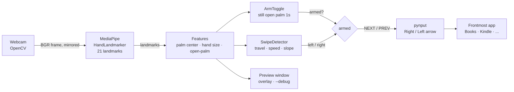

# pgest

Turn pages in Apple Books, Kindle, or any reader with a hand swipe. `pgest` watches your webcam, tracks your hand with MediaPipe, and sends Left/Right arrow keypresses to whichever app is in front.

- Swipe **left** → next page (Right arrow)
- Swipe **right** → previous page (Left arrow)
- Hold an **open palm still for 1s** → arm / disarm (so scratching your nose doesn't turn the page)

## Architecture



| Module | Role |
| --- | --- |
| `pageturner/app.py` | Camera loop, FPS cap, wiring, key injection, preview overlay |
| `pageturner/gestures.py` | Pure gesture logic (no camera/OS deps), unit-tested |
| `tests/test_gestures.py` | Synthetic-input tests for swipes, cooldown, arming |

**How a swipe is detected.** Each frame the palm center (mean of wrist + 4 knuckles) is added to a 0.6s window. Distances are measured in *hand-sizes* (wrist→middle knuckle), so thresholds hold whether you sit near or far from the camera. A swipe fires when horizontal travel, mean speed, and straightness all clear their thresholds. A 0.9s cooldown swallows the return stroke. Rightward swipes use lower thresholds than leftward ones because an outward right-handed swipe is naturally shorter and slower. These values were tuned from real swipe data and live in `SwipeDetector` in `gestures.py`.

## Setup

Requires macOS, a webcam, and [uv](https://docs.astral.sh/uv/).

```bash
git clone https://github.com/vikbht/pgest && cd pgest
uv sync
mkdir -p models && curl -fsSL -o models/hand_landmarker.task \
  https://storage.googleapis.com/mediapipe-models/hand_landmarker/hand_landmarker/float16/latest/hand_landmarker.task
```

Python is pinned to 3.12 and MediaPipe to 0.10.21. MediaPipe 1.0.x crashed on startup in testing ("Service is unavailable").

**macOS permissions** (granted to the app you launch from, e.g. Terminal; restart it after toggling):
- *Camera*: for hand tracking
- *Accessibility*: for sending arrow keys (not needed for `--dry-run`)

## Usage

```bash
uv run python -m pageturner --dry-run   # print gestures, send nothing
uv run python -m pageturner             # live: click into Books/Kindle first
```

| Flag | Effect |
| --- | --- |
| `--dry-run` | Print gestures instead of sending keys |
| `--debug` | Print why near-miss swipes were rejected (travel/speed/arc) |
| `--next left\|right` | Which swipe direction means NEXT (default `left`) |
| `--fps N` | Processing rate cap, lower saves battery (default 20) |
| `--always-armed` | Skip the open-palm arming step |
| `--no-preview` | No preview window |
| `--camera N` | Camera index |

Press `q` in the preview window to quit.

## Tuning

If swipes are missed or misfire, run with `--debug` and compare the printed `miss` lines against the thresholds in `SwipeDetector` (`min_travel`, `min_speed`, `right_travel`, `right_speed`, `max_slope`, `cooldown_s`).

## Tests

```bash
uv run pytest
```

## Roadmap

- Menu-bar wrapper
- Windows / Linux key injection and packaging
- Left-handed profile, optional pose gestures
